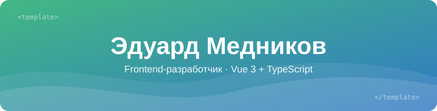

  

  

  
  

<h3 align="center">👋 Обо мне</h3>

В продуктовой команде берусь за задачи целиком, от API-слоя до UI и тестов, работаю по хэндбуку команды и через код-ревью.

Делаю то, на чём держится продукт: сложные формы с валидацией, редакторы контента, права доступа и интеграции с бэкендом по OpenAPI. Мне важно, чтобы код был понятным, типобезопасным и покрытым тестами, а интерфейс работал предсказуемо даже при упавших запросах и медленной сети.

Иду в сторону fullstack: разбираюсь, как устроен бэкенд, и проектирую фичи от базы данных до интерфейса.

<h3 align="center">🧰 Стек</h3>

  

  <b>Каждый день:</b> Vue 3 (Composition API) · TypeScript · Pinia · Vue Router · Element Plus · vee-validate + Zod · Axios · Tiptap · Vitest + Vue Test Utils · Vite · SCSS

  <b>Знаком / работал раньше:</b> React · Next.js · Redux Toolkit · TanStack Query · Tailwind CSS · Framer Motion

<h3 align="center">🌱 Сейчас изучаю</h3>

  

  <b>Nuxt</b> — SSR и fullstack на Vue · <b>Python + Django</b> — бэкенд: модели, API, тесты

